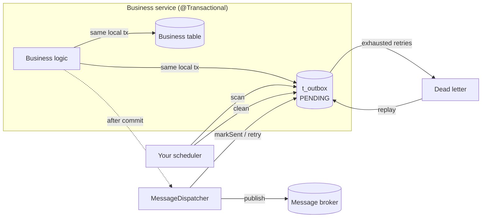

# reliable-outbox

**English** | [简体中文](README.zh-CN.md)

[](LICENSE)
[](https://adoptium.net/)
[](https://spring.io/projects/spring-boot)
[](https://central.sonatype.com/artifact/com.lazycece.outbox/reliable-outbox-spring-boot-starter)

A reliable messaging component for Java and Spring Boot, built on the
[Transactional Outbox](https://microservices.io/patterns/data/transactional-outbox.html) pattern.
Business data and an outbox record are written atomically in one local transaction; the message is
published to a broker only after that transaction commits. Failed publishes are retried through
lease-based claiming and a database sweep, delivering **at-least-once**.

---

## Why reliable-outbox

Sending a message and committing a database transaction are two separate operations. If the app
crashes between them, or the broker is briefly unavailable, you get either a lost message or a
message for data that never committed.

reliable-outbox closes that gap without a distributed transaction or a heavyweight MQ transaction
feature:

- Write your business row and an outbox row in the **same local transaction**.
- Publish after commit; on failure, retry from the outbox table.
- If the process dies, a periodic scan re-publishes anything still pending.

You get end-to-end eventual consistency with a plain relational database and any message broker.

## Features

- **Atomic write** — business data and the outbox record commit or roll back together.
- **At-least-once delivery** — retries, lease recovery, and crash recovery never lose a message.
  Consumers must be idempotent.
- **Broker-agnostic** — `MessagePublisher` is an SPI. Official adapters ship for Kafka and
  RocketMQ; provide your own for any other broker.
- **Scheduling-agnostic** — no embedded scheduler. The scanner and cleaner are plain methods you
  drive from Spring `@Scheduled`, xxl-job, ElasticJob, or any scheduler.
- **Multi-instance safe** — row-level lease (`owner_token`) claiming; no leader election required.
- **Failure handling** — configurable backoff retries, dead-letter state, and manual replay.
- **Management operations** — batch, `msg_id`-based dead-letter replay, immediate retry, forced dead
  marking, and dead-letter deletion. State-only; the scanner still performs delivery.
- **Bounded retention** — successful messages are deleted in batches; dead letters are retained for
  investigation.
- **Explicit transaction boundaries** — `sendInTransaction` joins the caller's transaction;
  `sendStandalone` commits independently.

## Architecture



| Component | Responsibility |
| --- | --- |
| `MessageClient` | Entry point: `sendInTransaction`, `sendStandalone`; validation, persistence, post-commit trigger |
| `OutboxRepository` | Outbox table read/write, state transitions, row-level lease claiming |
| `MessageDispatcher` | Claims, publishes, persists success/failure, schedules retries |
| `MessagePublisher` | Publishes to a broker (SPI) |
| `MessageScanner` | `scan()` finds due PENDING messages — the only scheduling source for first publish and retries |
| `OutboxCleaner` | `clean()` / `clean(shardItem, shardTotal)` deletes dispatched, expired rows |
| `DeadLetterHandler` / `DeadLetterReplayer` | Dead-letter logging/alerts and conditional manual replay |
| `OutboxAdminService` | Batch `msg_id`-based management: replay, retry now, force dead, delete (state-only) |
| `MessageListener` | Publish success/failure/dead-letter events for metrics and alerting |

## Modules

| Module | Description |
| --- | --- |
| `reliable-outbox-core` | Core SPI, JDBC repository, dispatcher, scanner, cleaner, dead-letter handling |
| `reliable-outbox-spring-boot-starter` | Spring Boot auto-configuration and `reliable-outbox.*` properties |
| `reliable-outbox-kafka` | Kafka `MessagePublisher` adapter, reusing Spring Boot's `KafkaTemplate` |
| `reliable-outbox-rocketmq` | RocketMQ `MessagePublisher` adapter on RocketMQ client 5.x |
| `reliable-outbox-sample` | Runnable Kafka and RocketMQ demos (H2 + Docker Compose) |
| `reliable-outbox-test` | Aggregator for the integration test suites (not published) |

## Quick start

### 1. Create the outbox table

Run the DDL in your business database (the component does **not** create tables for you):

```text
docs/ddl/mysql/t_outbox.sql
```

The default table name is `t_outbox`; override it with `reliable-outbox.table-name`.

### 2. Add dependencies

Add the starter plus one broker adapter. For Kafka:

```xml
<dependency>
    <groupId>com.lazycece.outbox</groupId>
    <artifactId>reliable-outbox-spring-boot-starter</artifactId>
    <version>${reliable-outbox.version}</version>
</dependency>
<dependency>
    <groupId>com.lazycece.outbox</groupId>
    <artifactId>reliable-outbox-kafka</artifactId>
    <version>${reliable-outbox.version}</version>
</dependency>
```

The Kafka adapter reuses Spring Boot's `KafkaTemplate`; configure producers with `spring.kafka.*`.
Publish acknowledgment timeout is `reliable-outbox.kafka.send-timeout` (default 5s).

For RocketMQ, use `reliable-outbox-rocketmq`. It reuses an existing `DefaultMQProducer` bean, or
creates one from `reliable-outbox.rocketmq.namesrv-addr` / `producer-group`. The outbox `msgId` is
written to the message `keys` and the `outbox-msg-id` user property; `partitionKey` is ignored
because ordering is not a component guarantee.

Enable only one broker adapter per application. If several are on the classpath, disable the extras
with `reliable-outbox.<broker>.enabled=false`. To use another broker, provide your own
`MessagePublisher` bean — adapters step aside automatically.

### 3. Send within a transaction

```java
@Transactional
public void placeOrder(Order order) {
    orderRepository.save(order);

    OutboxMessage message = new OutboxMessage();
    message.setBizCode("order");
    message.setTopic("order-events");
    message.setPartitionKey(order.getId());
    message.setPayload(toJson(order));               // final, deliverable bytes
    message.setHeaders("{\"source\":\"order-service\"}");
    messageClient.sendInTransaction(message);         // joins the current transaction
}
```

`sendInTransaction` runs with `MANDATORY` semantics and must be called inside a transaction.
`sendStandalone` runs in a new transaction and is unaffected by the caller's rollback.

### 4. Drive the scanner and cleaner

The component embeds no scheduling. Call `scan()` and `clean()` from your own scheduler:

```java
@Scheduled(fixedDelay = 1_000)
void scan() {
    messageScanner.scan();       // first publish and retry scheduling
}

@Scheduled(fixedDelay = 600_000)
void clean() {
    outboxCleaner.clean();       // or clean(shardItem, shardTotal) under a sharded scheduler
}
```

### 5. Management operations (optional)

When a dead letter is detected (usually from an alert), you dispose of it by `msg_id`. The component
exposes only in-library, state-only operations — no query, list, web console, permissions, or audit;
those belong to the integrator. Delivery is still performed by the scanner, never inside the admin
call.

```java
@Autowired OutboxAdminService outboxAdminService;

outboxAdminService.replayDead(msgIds);            // DEAD -> PENDING, resets retry/error, due now
outboxAdminService.retryPendingNow(msgIds);       // PENDING -> due now (keeps retry count/error)
outboxAdminService.markDead(msgIds, "poison");    // PENDING -> DEAD, reason stored in last_error
outboxAdminService.deleteDead(msgIds);            // delete DEAD rows
```

All four are idempotent conditional updates; operations on PENDING rows also require a free lease, so
they never race an in-flight dispatcher into a double publish. Inputs are chunked by
`reliable-outbox.admin.chunk-size` (default 20). The service is auto-registered only when the active
`OutboxRepository` also implements `OutboxAdminRepository` (built in for `JdbcOutboxRepository`;
disable with `reliable-outbox.admin.enabled=false`). 

### 6. Configure

Properties use the `reliable-outbox` prefix:

```yaml
reliable-outbox:
  table-name: t_outbox
  kafka:
    send-timeout: 5s
```

See §8.2 of the [design document](docs/design/reliable-outbox.md) for the full configuration model.

## Delivery semantics

- **At-least-once.** Retries, lease recovery, multi-instance scans, and crash recovery can all
  produce duplicates. Consumers must be idempotent.
- **No ordering guarantee.** Delivery within the same `partition_key` may be reordered. If you need
  ordering, guarantee it yourself: serialize commits on the producer, partition by key in the
  broker, and consume serially per key or use version-based conditional updates.
- **Size limits.** Payload ≤ 65,535 bytes (`TEXT`) and headers ≤ 1,024 bytes (`VARCHAR(1024)`) by
  default; oversized messages are rejected at the entry point with `MessageTooLargeException` and
  are not persisted.
- **Time.** All timestamps use JVM local time via `LocalDateTime`; columns are `DATETIME(3)`
  (millisecond precision), with no timezone conversion.
- **Publish contract.** A normal return from `MessagePublisher.publish` means the broker has
  acknowledged the message. Publishers should set their own send timeout.

## Samples

Ready-to-run demos use H2 (in-memory) plus Docker Compose and expose HTTP endpoints to place orders
and observe outbox state, retries, dead letters, and replay:

- Kafka: [`reliable-outbox-sample-kafka`](reliable-outbox-sample/reliable-outbox-sample-kafka/README.md)
- RocketMQ: [`reliable-outbox-sample-rocketmq`](reliable-outbox-sample/reliable-outbox-sample-rocketmq/README.md)

## Compatibility

| Item | Version |
| --- | --- |
| Java | 17+ |
| Spring Boot | 4.x |
| RocketMQ client | 5.x |
| Default DDL | MySQL (`docs/ddl/mysql/t_outbox.sql`) |
| Build | Maven 3.8+ |

The core is a plain library over Spring JDBC/Transaction APIs. Database dialects and table layouts
can be adapted through the `OutboxRepository` SPI.

## Building and testing

```bash
# Build and install all modules
mvn -q clean install -DskipTests

# Run tests
mvn test
```

## Documentation

- [Design document (Chinese)](docs/design/reliable-outbox.md) — architecture, data model, state
  machine, config, SPI, and operations
- [Kafka sample](reliable-outbox-sample/reliable-outbox-sample-kafka/README.md)
- [RocketMQ sample](reliable-outbox-sample/reliable-outbox-sample-rocketmq/README.md)

## Contributing

Issues and pull requests are welcome. Please keep the design constraints in mind — at-least-once
delivery, no ordering guarantee, and no embedded scheduler — and run `mvn test` before opening a PR.

## License

[Apache License 2.0](LICENSE) © lazycece
