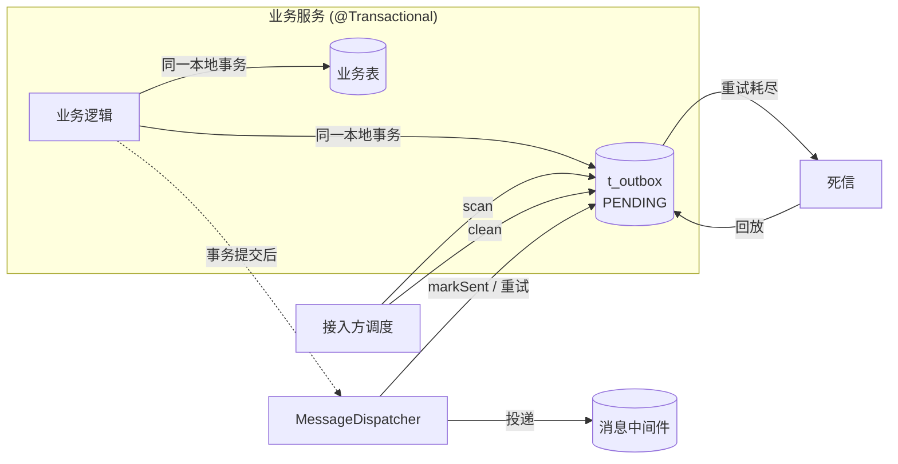

# reliable-outbox

[English](README.md) | **简体中文**

[](LICENSE)
[](https://adoptium.net/)
[](https://spring.io/projects/spring-boot)
[](https://central.sonatype.com/artifact/com.lazycece/reliable-outbox-spring-boot-starter)

一个面向 Java 与 Spring Boot 的可靠消息组件，基于
[Transactional Outbox](https://microservices.io/patterns/data/transactional-outbox.html)（本地消息表）模式。
业务数据与 Outbox 记录在同一个本地事务内原子写入，事务提交后才把消息投递到消息中间件；投递失败时，
通过租约抢占与数据库扫描兜底重试，实现**至少一次**投递。

---

## 为什么用 reliable-outbox

发送消息和提交数据库事务是两个独立操作。若在两者之间宕机，或中间件短暂不可用，就会出现消息丢失，
或发出了一条对应数据并未真正提交的消息。

reliable-outbox 无需分布式事务，也不依赖 MQ 的事务消息能力，即可消除这一不一致：

- 在**同一个本地事务**内写入业务行与 Outbox 行；
- 事务提交后再投递，失败则从 Outbox 表重试；
- 进程崩溃后，由周期扫描重新投递仍未完成的消息。

只需普通关系型数据库和任意消息中间件，即可获得端到端的最终一致性。

## 特性

- **原子写入**：业务数据与 Outbox 记录一起提交或一起回滚。
- **至少一次投递**：重试、租约回收与崩溃恢复都不会丢消息；消费端必须幂等。
- **与 MQ 解耦**：`MessagePublisher` 为 SPI，官方提供 Kafka 与 RocketMQ 适配器，其他中间件可自行实现。
- **与调度解耦**：不内置调度线程。扫描器与清理器是普通方法，可由 Spring `@Scheduled`、xxl-job、
  ElasticJob 等任意调度框架驱动。
- **多实例安全**：基于行级租约（`owner_token`）抢占，无需选主。
- **失败治理**：可配置退避重试、转入死信、人工回放。
- **有序保留与清理**：成功消息分批清理；死信保留以便排查。
- **明确的事务边界**：`sendInTransaction` 加入调用方事务；`sendStandalone` 独立提交。

## 架构



| 组件 | 职责 |
| --- | --- |
| `MessageClient` | 对外入口：`sendInTransaction`、`sendStandalone`；负责校验、落库与提交后触发 |
| `OutboxRepository` | Outbox 表读写、状态流转、行级租约抢占 |
| `MessageDispatcher` | 抢占、投递、落库成功/失败状态、安排重试 |
| `MessagePublisher` | 向具体 MQ 投递（SPI） |
| `MessageScanner` | `scan()` 扫描到期的 PENDING 消息，是首次投递与重试的唯一调度来源 |
| `OutboxCleaner` | `clean()` / `clean(shardItem, shardTotal)` 分批清理已投递的过期记录 |
| `DeadLetterHandler` / `DeadLetterReplayer` | 死信日志/告警与带状态条件的人工回放 |
| `MessageListener` | 投递成功/失败/死信事件，用于指标与告警扩展 |

## 模块

| 模块 | 说明 |
| --- | --- |
| `reliable-outbox-core` | 核心 SPI、JDBC 仓储、调度投递、扫描、清理、死信处理 |
| `reliable-outbox-spring-boot-starter` | Spring Boot 自动装配与 `reliable-outbox.*` 配置 |
| `reliable-outbox-kafka` | Kafka `MessagePublisher` 适配器，复用 Spring Boot 的 `KafkaTemplate` |
| `reliable-outbox-rocketmq` | 基于 RocketMQ client 5.x 的 `MessagePublisher` 适配器 |
| `reliable-outbox-sample` | 可直接运行的 Kafka / RocketMQ 示例（H2 + Docker Compose） |
| `reliable-outbox-test` | 集成测试套件聚合模块（不发布） |

## 快速开始

### 1. 创建 Outbox 表

在业务库执行 DDL（组件**不会**自动建表）：

```text
docs/ddl/mysql/t_outbox.sql
```

默认表名为 `t_outbox`，可通过 `reliable-outbox.table-name` 修改。

### 2. 引入依赖

引入 starter 与一个 MQ 适配器。以 Kafka 为例：

```xml
<dependency>
    <groupId>com.lazycece.outbox</groupId>
    <artifactId>reliable-outbox-spring-boot-starter</artifactId>
    <version>${reliable-outbox.version}</version>
</dependency>
<dependency>
    <groupId>com.lazycece.outbox</groupId>
    <artifactId>reliable-outbox-kafka</artifactId>
    <version>${reliable-outbox.version}</version>
</dependency>
```

Kafka 适配器复用 Spring Boot 的 `KafkaTemplate`，生产者通过 `spring.kafka.*` 配置；发送确认超时由
`reliable-outbox.kafka.send-timeout` 配置（默认 5 秒）。

RocketMQ 使用 `reliable-outbox-rocketmq`：容器中存在 `DefaultMQProducer` bean 时直接复用，否则按
`reliable-outbox.rocketmq.namesrv-addr` / `producer-group` 创建并启动。Outbox 的 `msgId` 会写入消息
`keys` 与用户属性 `outbox-msg-id`；`partitionKey` 不做处理（组件不承诺顺序）。

同一应用只应启用一个 MQ 适配器；多个适配器共存时用 `reliable-outbox.<broker>.enabled=false` 关闭其余。
若使用其他中间件，提供自定义 `MessagePublisher` bean 即可，适配器会自动让位。

### 3. 在事务中发送

```java
@Transactional
public void placeOrder(Order order) {
    orderRepository.save(order);

    OutboxMessage message = new OutboxMessage();
    message.setBizCode("order");
    message.setTopic("order-events");
    message.setPartitionKey(order.getId());
    message.setPayload(toJson(order));               // 最终可投递的字节
    message.setHeaders("{\"source\":\"order-service\"}");
    messageClient.sendInTransaction(message);         // 加入当前事务
}
```

`sendInTransaction` 采用 `MANDATORY` 语义，必须在事务内调用；`sendStandalone` 使用新事务，不随调用方
外层事务回滚。

### 4. 驱动扫描与清理

组件不内置调度，由接入方在自己的调度框架中调用：

```java
@Scheduled(fixedDelay = 1_000)
void scan() {
    messageScanner.scan();       // 首次投递与重试调度
}

@Scheduled(fixedDelay = 600_000)
void clean() {
    outboxCleaner.clean();       // 分片调度时可改用 clean(shardItem, shardTotal)
}
```

### 5. 配置

配置项统一以 `reliable-outbox` 为前缀：

```yaml
reliable-outbox:
  table-name: t_outbox
  kafka:
    send-timeout: 5s
```

完整配置模型见[设计文档](docs/design/reliable-outbox.md)第 8.2 节。

## 投递语义

- **至少一次**：重试、租约回收、多实例扫描与崩溃恢复都可能产生重复，消费端必须幂等。
- **不承诺顺序**：同一 `partition_key` 内也可能乱序。需要顺序的业务须自行保证：生产端串行提交、
  Broker 按 key 分区、消费端按 key 串行消费或使用版本号条件更新。
- **大小限制**：默认 payload ≤ 65,535 字节（`TEXT`）、headers ≤ 1,024 字节（`VARCHAR(1024)`）；
  超限在入口直接抛出 `MessageTooLargeException`，且不落库。
- **时间**：统一使用 JVM 本地时间，代码层直接使用 `LocalDateTime`，列类型 `DATETIME(3)`（毫秒精度），
  不做时区换算。
- **投递契约**：`MessagePublisher.publish` 正常返回即代表 Broker 已确认；Publisher 应自行设置发送超时。

## 示例

可直接运行的示例使用 H2 内存库与 Docker Compose，通过 HTTP 接口下单并观察 Outbox 状态、重试、死信与回放：

- Kafka：[`reliable-outbox-sample-kafka`](reliable-outbox-sample/reliable-outbox-sample-kafka/README.md)
- RocketMQ：[`reliable-outbox-sample-rocketmq`](reliable-outbox-sample/reliable-outbox-sample-rocketmq/README.md)

## 兼容性

| 项 | 版本 |
| --- | --- |
| Java | 17+ |
| Spring Boot | 4.x |
| RocketMQ client | 5.x |
| 默认 DDL | MySQL（`docs/ddl/mysql/t_outbox.sql`） |
| 构建 | Maven 3.8+ |

核心库基于 Spring JDBC/Transaction 的普通 API，数据库方言与表结构可通过 `OutboxRepository` SPI 适配。

## 构建与测试

```bash
# 构建并安装所有模块
mvn -q clean install -DskipTests

# 运行测试
mvn test
```

## 文档

- [设计文档](docs/design/reliable-outbox.md)：架构、数据模型、状态机、配置、SPI 与运维
- [Kafka 示例](reliable-outbox-sample/reliable-outbox-sample-kafka/README.md)
- [RocketMQ 示例](reliable-outbox-sample/reliable-outbox-sample-rocketmq/README.md)

## 贡献

欢迎提交 Issue 与 Pull Request。请遵循组件的设计约束——至少一次投递、不承诺顺序、不内置调度——并在
提交前运行 `mvn test`。

## 许可证

[Apache License 2.0](LICENSE) © lazycece
